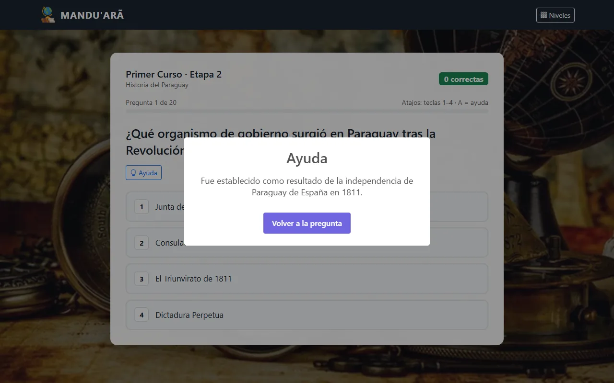
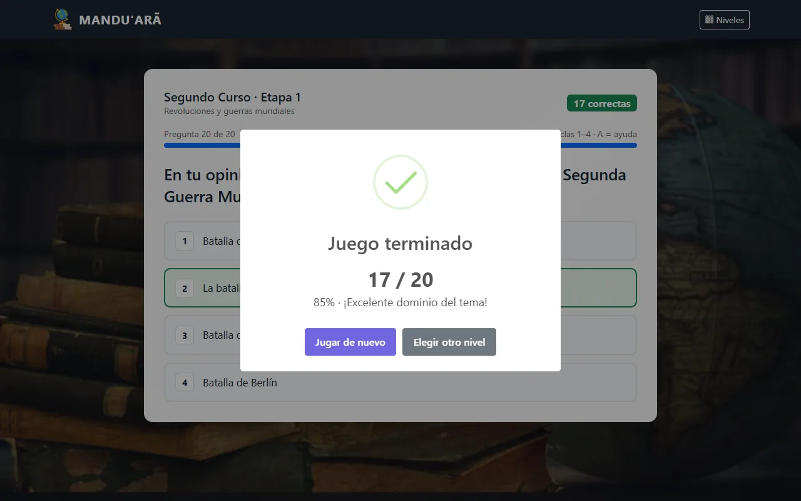
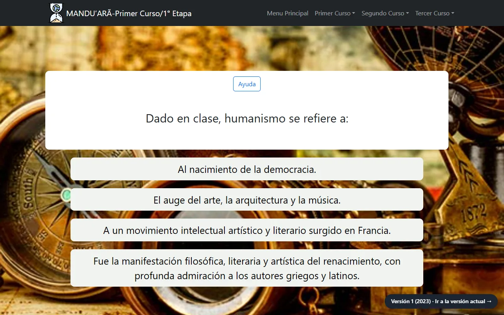

<div align="center">


# MANDU'ARÃ · Jugá y aprendé Historia

Juego de preguntas de Historia para estudiantes de **1°, 2° y 3° curso**: del mundo clásico a la historia del Paraguay.

[](https://vecs0.github.io/manduara.dev/)
[-gray?style=for-the-badge&logo=github)](https://vecs0.github.io/manduara.dev/v1/)


<a href="https://vecs0.github.io/manduara.dev/">
  
</a>

</div>

---

##  Demo

**[https://vecs0.github.io/manduara.dev/](https://vecs0.github.io/manduara.dev/)**

Se juega desde el navegador, en computadora o celular, sin instalar nada.

| Nivel | Enlace directo |
|---|---|
| 1° Curso · Etapa 1: del mundo clásico a la Edad Moderna | [Jugar](https://vecs0.github.io/manduara.dev/quiz.html?curso=1&etapa=1) |
| 1° Curso · Etapa 2: historia del Paraguay | [Jugar](https://vecs0.github.io/manduara.dev/quiz.html?curso=1&etapa=2) |
| 2° Curso · Etapa 1: revoluciones y guerras mundiales | [Jugar](https://vecs0.github.io/manduara.dev/quiz.html?curso=2&etapa=1) |
| 2° Curso · Etapa 2: independencias y economía | [Jugar](https://vecs0.github.io/manduara.dev/quiz.html?curso=2&etapa=2) |
| 3° Curso · Etapa 1: partidos y movimientos sociales | [Jugar](https://vecs0.github.io/manduara.dev/quiz.html?curso=3&etapa=1) |
| 3° Curso · Etapa 2: Paraguay contemporáneo | [Jugar](https://vecs0.github.io/manduara.dev/quiz.html?curso=3&etapa=2) |

##  Funcionalidades

- **6 niveles y 119 preguntas** organizadas por curso y etapa.
- **Orden aleatorio** de preguntas y opciones en cada partida.
- **Ayuda contextual** con pista e imagen. El botón aparece solo si la pregunta tiene ayuda.
- **Feedback inmediato**: marca la respuesta correcta y la elegida.
- **Progreso y puntaje** en tiempo real.
- **Resultado final** con porcentaje y opción de reintentar o cambiar de nivel.
- **Atajos de teclado**: `1`–`4` para responder, `A` para la ayuda.
- **Diseño responsive** y opciones accesibles con teclado.

##  Capturas

| Elegir nivel | Pregunta |
|---|---|
|  |  |
| **Ayuda con imagen** | **Respuesta** |
|  |  |
| **Resultado final** | **Versión móvil** |
|  |   |

##  Tecnologías

| Tecnología | Uso |
|---|---|
| **HTML5 · CSS3 · JavaScript (ES6+)** | Base del proyecto, sin frameworks ni proceso de build |
| **[Bootstrap 5](https://getbootstrap.com/) + Bootstrap Icons** | Layout responsive, navegación e íconos |
| **[SweetAlert2](https://sweetalert2.github.io/)** | Ventanas de feedback, ayuda y resultado |
| **GitHub Pages** | Hosting y despliegue |

##  Estructura

```
manduara.dev/
├── index.html              # Portada y selección de niveles
├── quiz.html               # Página del juego (?curso=N&etapa=M)
├── assets/
│   ├── css/main.css        # Estilos propios
│   ├── js/niveles.js       # Catálogo de cursos, etapas y temas
│   ├── js/quiz.js          # Lógica del juego
│   └── img/                # Logo, fondos e imágenes de ayuda (WebP)
├── data/
│   └── curso-N-etapa-M.js  # Bancos de preguntas
├── docs/                   # Capturas e íconos del README
└── v1/                     # Versión original de 2023 (solo lectura)
```

Una sola página (`quiz.html`) sirve los 6 niveles: lee `curso` y `etapa` de la URL y carga el banco de preguntas que corresponde.

##  Correr en local

```bash
git clone https://github.com/vecs0/manduara.dev.git
cd manduara.dev
python -m http.server 8000
```

Después abrí http://localhost:8000. También funciona abriendo `index.html` directamente.

##  Agregar preguntas

Cada banco en `data/` es una lista de objetos:

```js
{
  pregunta: "¿Cuál es la cuna del Renacimiento?",
  respuesta: "Italia",
  distractores: ["Francia", "España", "Inglaterra"],
  ayuda: "Texto de pista (opcional)",
  ayudaImg: "assets/img/preguntas/italia.webp" // opcional
}
```

##  Versiones

| Versión | Estado | Enlace |
|---|---|---|
| **v2 (2026)** | Actual | [vecs0.github.io/manduara.dev](https://vecs0.github.io/manduara.dev/) |
| **v1 (2023)** | Archivada, se conserva tal como era | [vecs0.github.io/manduara.dev/v1](https://vecs0.github.io/manduara.dev/v1/) |

| Versión 1 (2023) | Versión 2 (2026) |
|---|---|
|  |  |

##  Historial del proyecto

**v1 · 2023: primera versión**
- Quiz con 6 niveles, cada uno con su propia página HTML y hoja de estilos.

**v2 · 2026: refactor completo**
- Una sola página de juego en lugar de 6 páginas duplicadas.
- Nueva portada con tarjetas de nivel.
- Imágenes optimizadas a WebP: de 9.5 MB a 2.4 MB.
- Corrección de preguntas con la respuesta duplicada entre los distractores y de opciones vacías.
- Accesibilidad, atajos de teclado y diseño responsive.
- La v1 se conserva en `/v1` como referencia.

##  Autor

<table>
  <tr>
    <td></td>
    <td>
      <strong>Victor Emmanuel Cabrera Sosa</strong><br>
      <a href="https://github.com/vecs0">vecs0 · github.com/vecs0</a>
    </td>
  </tr>
</table>

##  Licencia

Distribuido bajo la licencia **MIT**. Consultá el archivo [LICENSE](LICENSE) para el texto completo.

| Permisos | Condiciones | Limitaciones |
|---|---|---|
| ✔ Uso comercial<br>✔ Modificación<br>✔ Distribución<br>✔ Uso privado | Incluir el aviso de copyright y la licencia | ✖ Sin garantía<br>✖ Sin responsabilidad |

**Contenido de terceros:** Bootstrap, Bootstrap Icons y SweetAlert2 se distribuyen bajo sus propias licencias MIT. Las imágenes históricas pertenecen a sus respectivos autores, se usan con fines educativos y no están cubiertas por esta licencia.

© 2023 Victor Emmanuel Cabrera Sosa
