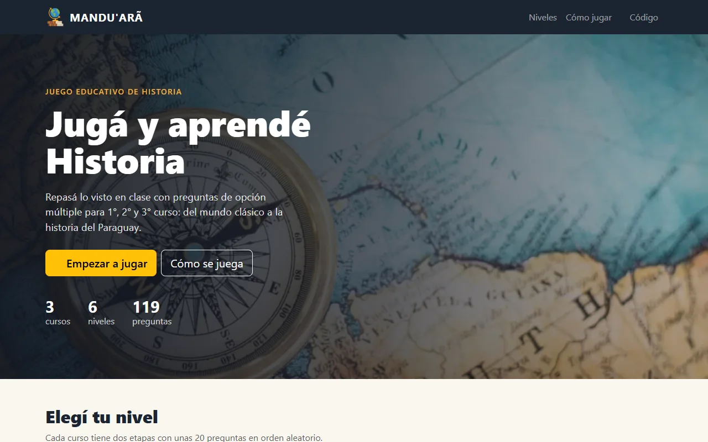
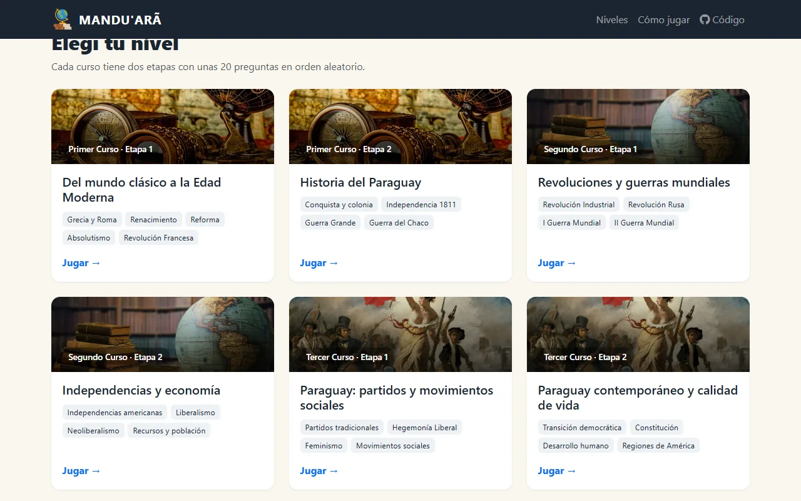
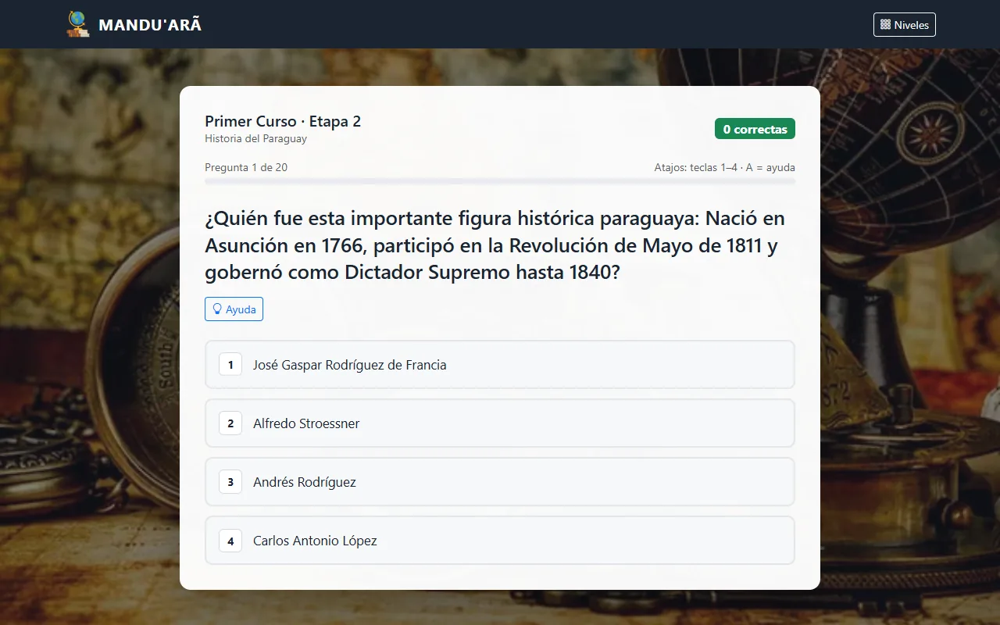
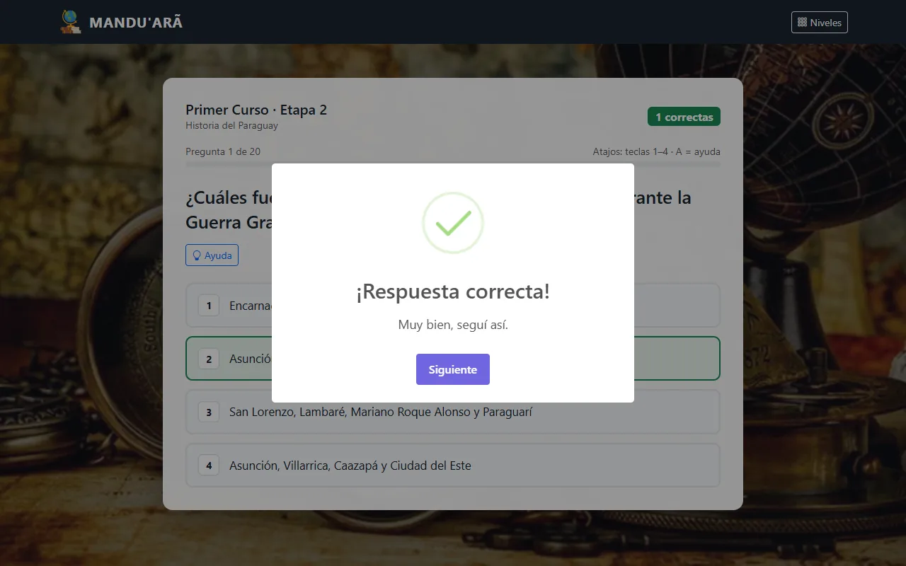
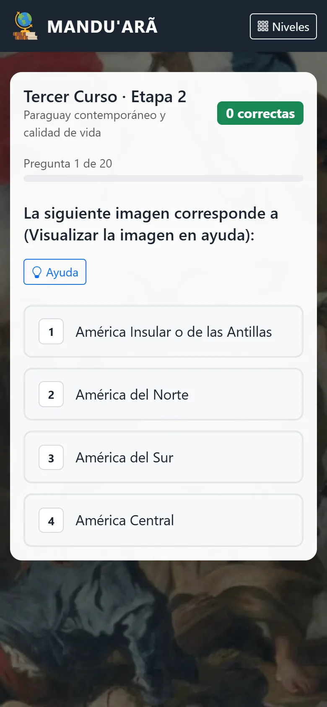
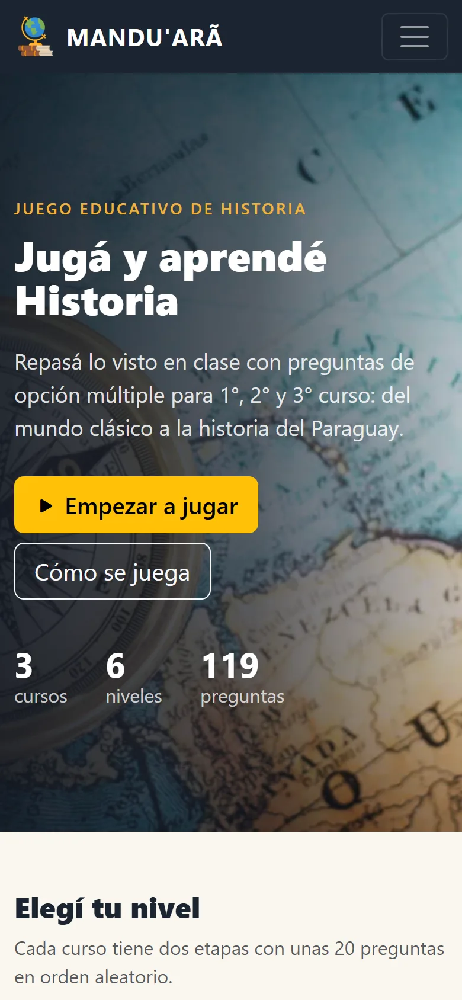

<div align="center">


# MANDU'ARÃ · Jugá y aprendé Historia

Juego de preguntas de Historia para estudiantes de **1°, 2° y 3° curso**: del mundo clásico a la historia del Paraguay.

[](https://vecs0.github.io/manduara.dev/)


<a href="https://vecs0.github.io/manduara.dev/">
  
</a>

</div>

---

## 🎮 Demo

**👉 [https://vecs0.github.io/manduara.dev/](https://vecs0.github.io/manduara.dev/)**

No hace falta instalar nada: se juega desde el navegador, en computadora o celular.

| Nivel | Enlace directo |
|---|---|
| 1° Curso · Etapa 1: mundo clásico a Edad Moderna | [Jugar](https://vecs0.github.io/manduara.dev/quiz.html?curso=1&etapa=1) |
| 1° Curso · Etapa 2: historia del Paraguay | [Jugar](https://vecs0.github.io/manduara.dev/quiz.html?curso=1&etapa=2) |
| 2° Curso · Etapa 1: revoluciones y guerras mundiales | [Jugar](https://vecs0.github.io/manduara.dev/quiz.html?curso=2&etapa=1) |
| 2° Curso · Etapa 2: independencias y economía | [Jugar](https://vecs0.github.io/manduara.dev/quiz.html?curso=2&etapa=2) |
| 3° Curso · Etapa 1: partidos y movimientos sociales | [Jugar](https://vecs0.github.io/manduara.dev/quiz.html?curso=3&etapa=1) |
| 3° Curso · Etapa 2: Paraguay contemporáneo | [Jugar](https://vecs0.github.io/manduara.dev/quiz.html?curso=3&etapa=2) |

## ✨ Funcionalidades

- **6 niveles y 119 preguntas** organizadas por curso y etapa.
- **Preguntas y opciones en orden aleatorio** en cada partida.
- **Botón de ayuda** con pista e imagen ilustrativa (aparece solo si la pregunta tiene ayuda).
- **Feedback inmediato**: resalta la respuesta correcta y la elegida.
- **Barra de progreso y contador** de respuestas correctas.
- **Resultado final** con porcentaje y opción de reintentar o cambiar de nivel.
- **Atajos de teclado**: `1`–`4` para responder, `A` para la ayuda.
- **Diseño responsive** y botones accesibles con teclado.

## 📸 Capturas

| Elegir nivel | Pregunta |
|---|---|
|  |  |
| **Ayuda con imagen** | **Respuesta** |
|  |  |
| **Resultado final** | **Versión móvil** |
|  |   |

## 🛠️ Tecnologías

- **HTML5, CSS3 y JavaScript (ES6+)** sin frameworks ni build.
- **[Bootstrap 5](https://getbootstrap.com/)** y **Bootstrap Icons** para el layout y los íconos.
- **[SweetAlert2](https://sweetalert2.github.io/)** para las ventanas de feedback y ayuda.
- **GitHub Pages** para el hosting.

## 📁 Estructura

```
manduara.dev/
├── index.html              # Portada y selección de niveles
├── quiz.html               # Página del juego (?curso=N&etapa=M)
├── assets/
│   ├── css/main.css        # Estilos propios
│   ├── js/niveles.js       # Catálogo de cursos, etapas y temas
│   ├── js/quiz.js          # Lógica del juego
│   └── img/                # Logo, fondos e imágenes de ayuda (WebP)
├── data/
│   └── curso-N-etapa-M.js  # Bancos de preguntas
└── docs/screenshots/       # Capturas del README
```

Una sola página (`quiz.html`) sirve los 6 niveles: lee `curso` y `etapa` de la URL y carga el banco de preguntas que corresponde.

## 🚀 Correr en local

```bash
git clone https://github.com/vecs0/manduara.dev.git
cd manduara.dev
python -m http.server 8000
```

Después abrí http://localhost:8000. También funciona abriendo `index.html` directamente.

## ➕ Agregar preguntas

Cada banco en `data/` es una lista de objetos:

```js
{
  pregunta: "¿Cuál es la cuna del Renacimiento?",
  respuesta: "Italia",
  distractores: ["Francia", "España", "Inglaterra"],
  ayuda: "Texto de pista (opcional)",
  ayudaImg: "assets/img/preguntas/italia.webp" // opcional
}
```

## 📝 Historial del proyecto

- **2023**: primera versión, con una página HTML y un CSS por cada nivel.
- **2026**: refactor completo:
  - una sola página de juego y estructura de carpetas
  - imágenes optimizadas (de 9.5 MB a 2.4 MB)
  - corrección de preguntas con la respuesta duplicada y de opciones vacías
  - accesibilidad y diseño responsive
  - nueva portada

## 👤 Autor

**vecs0** · [github.com/vecs0](https://github.com/vecs0)

## 📄 Licencia

El código está bajo licencia [MIT](LICENSE). Las imágenes históricas pertenecen a sus respectivos autores y se usan con fines educativos.
